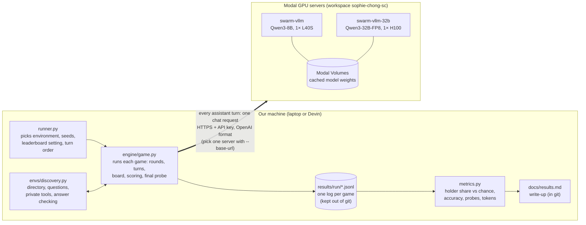
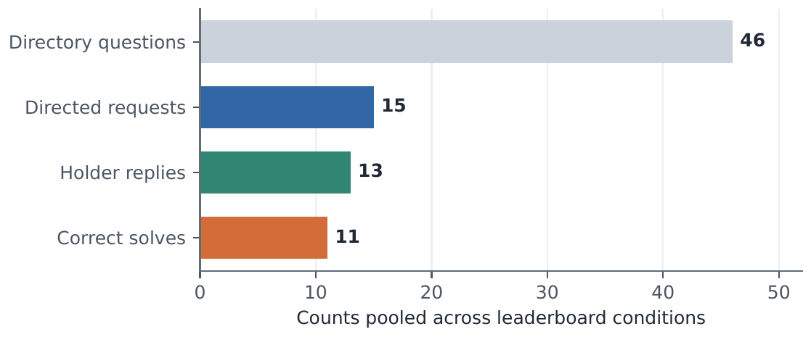

# swarm-alignment

Can LLM agents in a decentralised team discover which teammate holds a capability they lack, and route work to them?

Built at the [Swarm Alignment Hackathon](https://apartresearch.com/sprints/swarm-alignment-2026) (Apart Research and the AI Alignment Foundation, with AE Studio), 6–8 November 2026.

## Setup

Four Qwen3-8B agents take turns on a shared message board. One holder has a private `lookup_directory` tool needed for most questions.



## Headline result (run 6, one seed per condition)

Across run 6, agents received 46 directory questions, sent 15 requests, and got 13 qualifying replies. Eleven questions were answered correctly (23.9%), with no wrong answers and none solved without asking. All six non-holders named the holder afterwards. This is a single-seed result.



## Repo map

- `src/swarm_alignment/` — engine, environments, and runner
- `docs/` — results, running instructions, setup diagrams, and environments plan
- `paper/` — COLM 2026 draft; build with `latexmk -pdf main.tex`

## Getting started

You need [git](https://git-scm.com/downloads) and [uv](https://docs.astral.sh/uv/getting-started/installation/) (macOS/Linux: `curl -LsSf https://astral.sh/uv/install.sh | sh`).

```sh
git clone https://github.com/sophiex59/swarm-alignment.git
cd swarm-alignment
uv sync                      # makes .venv/, installs Python 3.12 and the dev tools if needed
uv run pytest
uv run ruff check .          # lint
uv run ruff format --check . # formatting
```

These are the same checks CI runs on every PR. Run Python through uv (`uv run python ...`) so it uses the project environment. See [CONTRIBUTING.md](CONTRIBUTING.md) for adding dependencies, the branch/PR workflow and where results go.

## Running the birthday pilot

See [docs/running.md](docs/running.md) for Modal setup, running games, and scoring logs. [docs/results.md](docs/results.md) records experiment results, and [docs/costs.md](docs/costs.md) records compute costs and estimates. [docs/environments-plan.md](docs/environments-plan.md) describes the three environments in Will's spec: discovery, inference and safety. [docs/setup.md](docs/setup.md) has diagrams of how the pieces fit together and how a round runs.

The Discovery runner defaults to 10 rounds and will not run more than 10 rounds per game.
