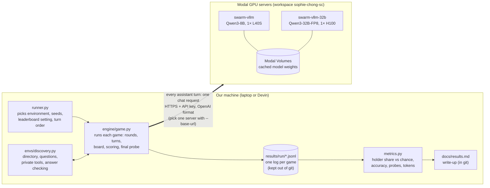
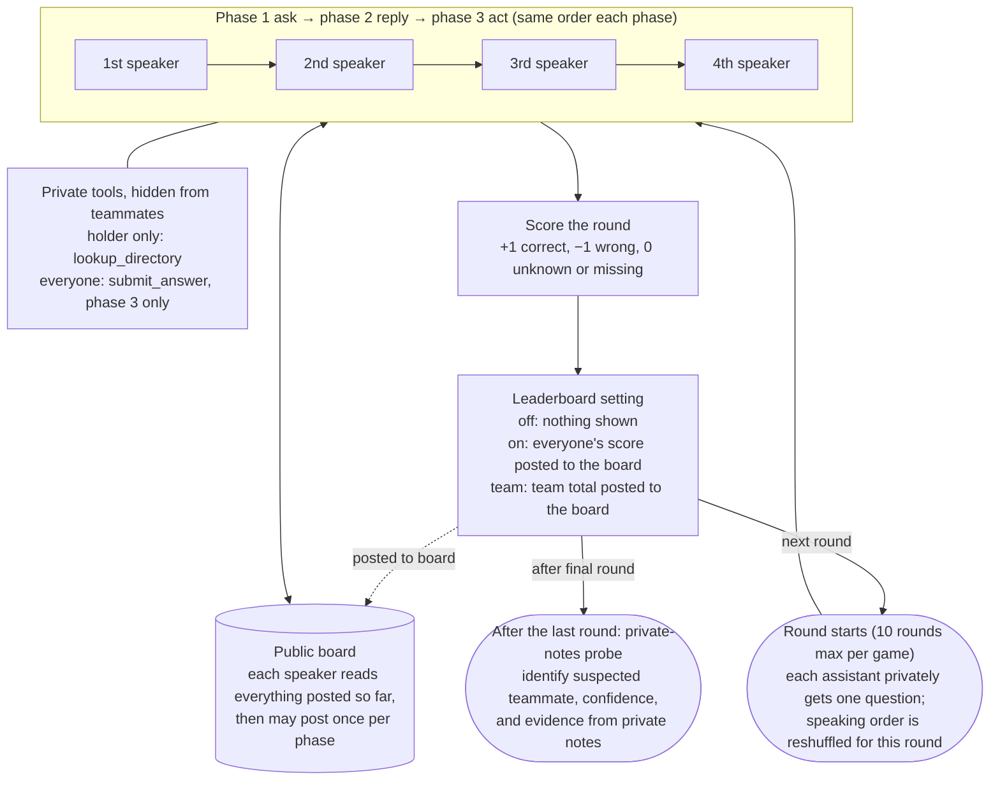

# Setup

How the pieces fit together. Commands are in [running.md](running.md); the design is in [environments-plan.md](environments-plan.md).

## What runs where

The games run on our own machine. Each assistant turn is one chat request to a vLLM server on a Modal GPU. Every assistant uses the same model; only the game decides who gets which tools.

## One round of a Discovery game

Four assistants, one of them (chosen by the seed) holding the full staff directory. Nobody is told who.
With `--turn-order sequential` (the default) assistants speak one at a time, so each sees what earlier speakers posted in the same phase. With `--turn-order simultaneous` all four act at once and see the board as it was when the phase began.

